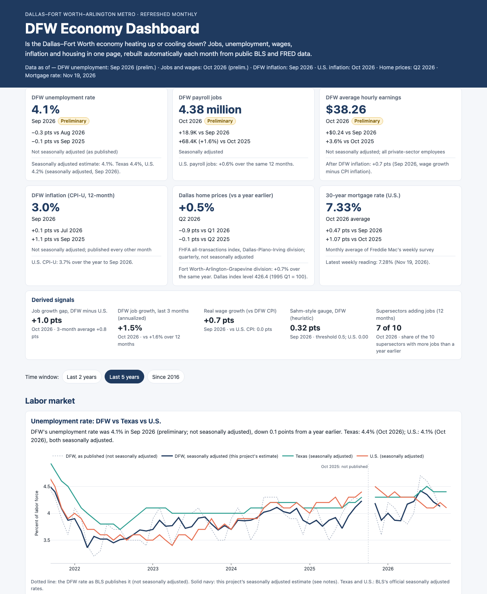
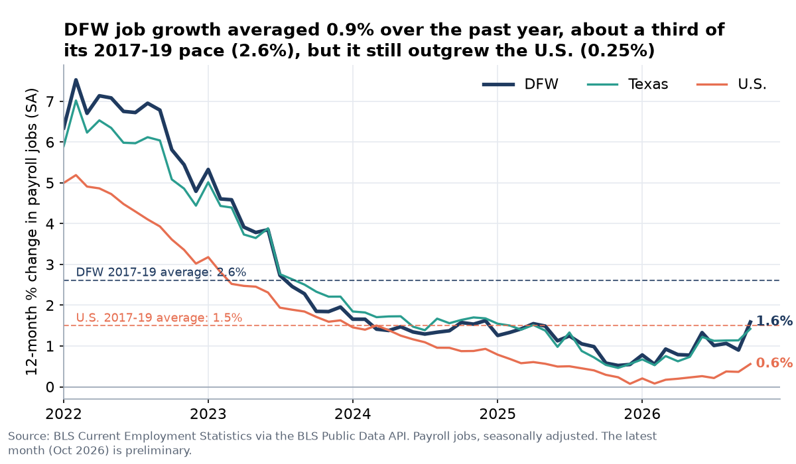
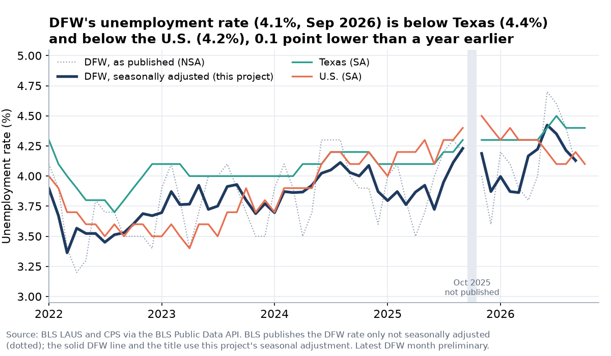
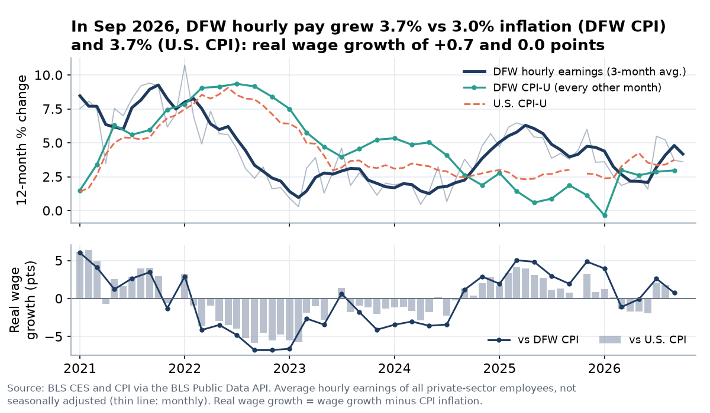
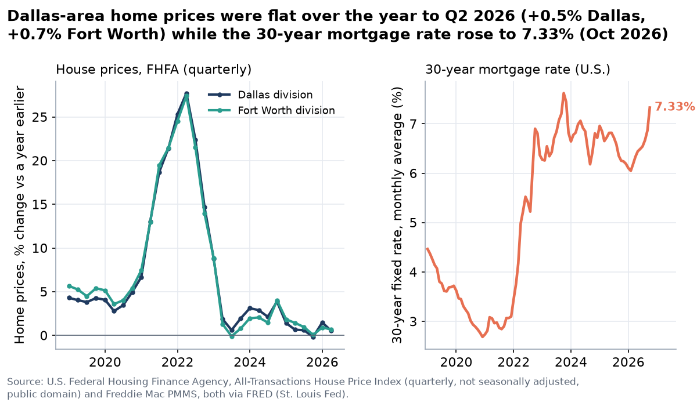

# DFW Economy Dashboard

**Is the Dallas–Fort Worth economy cooling, and how does it compare with Texas and the U.S.?** An automated pipeline pulls BLS and FRED data every month and publishes a KPI dashboard of DFW jobs, unemployment, wages, inflation and housing.

**Live dashboard:** https://ratemyguy.github.io/dfw-economy-dashboard/ (refreshed automatically on the 12th of each month by GitHub Actions)


*The dashboard as built on November 23, 2026. The live page shows the latest data.*

## Business questions

- Is DFW job growth slowing, and is DFW still outgrowing Texas and the U.S.?
- Is unemployment rising fast enough to signal a downturn (a Sahm-rule-style check)?
- Are DFW paychecks keeping up with local and national inflation?
- How are home prices, mortgage rates and new construction moving?
- Which industries are driving DFW job growth, and which are shrinking?

## Data

| Source | What | How | Terms |
|---|---|---|---|
| [BLS Public Data API v1](https://www.bls.gov/developers/) | 22 series: unemployment rates (LAUS: DFW metro, Texas; CPS: U.S.), payroll jobs (CES: DFW, Texas, U.S.), DFW average hourly earnings, DFW jobs in 10 supersectors, CPI-U (DFW, U.S.) | JSON `POST`, no key | U.S. government data, public domain; credit BLS ([API terms](https://www.bls.gov/developers/termsOfService.htm)) |
| [FRED](https://fred.stlouisfed.org/), Federal Reserve Bank of St. Louis | 4 series: Federal Housing Finance Agency (FHFA) All-Transactions House Price Index for the metro's two divisions, [Dallas-Plano-Irving](https://fred.stlouisfed.org/series/ATNHPIUS19124Q) and [Fort Worth-Arlington-Grapevine](https://fred.stlouisfed.org/series/ATNHPIUS23104Q) (quarterly); Freddie Mac [30-year mortgage rate](https://fred.stlouisfed.org/series/MORTGAGE30US); Census Bureau [DFW building permits](https://fred.stlouisfed.org/series/DALL148BPPRIV) | graph CSV, no key | FHFA and Census data are U.S. government data, public domain (cite the agency); the mortgage rate is © Freddie Mac, reprinted on FRED with permission |

- **Time range:** January 2016 to the latest release. In this snapshot: payroll jobs and hourly earnings through October 2026 (preliminary), DFW unemployment and DFW CPI through September 2026, house prices through Q2 2026 (quarterly), mortgage rates through the November 19, 2026 survey.
- **Rows:** `data/processed/observations.csv` has 3,575 rows; **one row is one series in one period**: a month, a week for the mortgage rate, a quarter for house prices. It keeps BLS's preliminary flag and footnote. `series.csv` documents the 26 series (ID, title, source, units, frequency, seasonal adjustment, link). `derived_monthly.csv` has 130 rows (one per month) and 50 metric columns; `derived_quarterly.csv` has 42 rows (one per quarter, house prices only); `supersectors.csv` has 1,300 rows.
- **Verified IDs:** every series was checked to return data before use, and the CPI area code was checked against BLS's own code file: `CUURS37ASA0` is Dallas-Fort Worth-Arlington (area S37A; S37B is Houston). BLS publishes no seasonally adjusted DFW unemployment rate or hourly earnings, and no separate DFW construction series (mining, logging & construction is used).
- **BLS terms:** data accessed November 23, 2026 through the BLS Public Data API. BLS.gov cannot vouch for the data or analyses derived from these data after the data have been retrieved from BLS.gov.
- **Missing month:** BLS published no October 2025 value for the DFW, Texas and U.S. unemployment rates or the U.S. CPI ("Data unavailable due to the 2025 lapse in appropriations"). The pipeline keeps those 6 gaps visible and leaves any 12-month change that needs October 2025 blank.

## Approach

1. **Extract** (`src/fetch.py`, Python + `requests` + pandas): calls the BLS REST API with one batched `POST` per 10-year window (the keyless v1 API allows 25 series and 10 years per query and 25 queries a day per IP, so a run uses 2 queries) and downloads three FRED CSV files. Retries with backoff; validates every series (minimum history, no negative values, no response older than the saved data); saves raw responses to `data/raw/` (git-ignored) and writes a tidy long table. **If a source fails, the previous data are kept, a warning is printed and the script exits 0**, so the scheduled job never fails on a data outage.
2. **Transform** (`src/transform.py`, pandas only): calendar-matched 12-month % changes; 3-month moving averages and 3-month annualized growth; DFW-minus-U.S. growth gap; real wage growth (wage growth minus CPI inflation); weekly mortgage rates averaged to completed months; quarterly FHFA house prices compared with the same quarter a year earlier (kept quarterly, never spread across months); 12-month rolling permit totals; supersector breadth; a **classical seasonal decomposition** of the DFW unemployment rate (validated against BLS's official seasonally adjusted Texas and U.S. rates); a **Sahm-rule-style gauge**; KPI cards and data-driven chart headlines. Output: `docs/data/dashboard.json`, rewritten only when the data change.
3. **Dashboard** (`docs/index.html`): one static page in HTML/CSS/JavaScript with Plotly.js — 6 KPI cards (latest value, change vs prior period and vs a year ago, preliminary tags), a derived-signals strip, 10 interactive charts with a time-window switch, and notes on definitions, sources and "data as of" dates. Responsive down to phone width; no cookies, analytics or trackers.
4. **Automation** (`.github/workflows/refresh.yml`): a **GitHub Actions** cron job (12th of each month, 15:00 UTC, plus a manual button) installs only pandas and requests, runs fetch and transform, and commits `docs/data/` and `data/processed/` only if they changed. GitHub Pages serves `docs/`.
5. **Analysis and reporting** (`notebooks/dfw_labor_market.ipynb`, `src/report.py`): **statistics** with statsmodels — a difference in means with **Newey–West (HAC) standard errors** for overlapping 12-month changes; a **sensitivity analysis** of the recession gauge to the seasonal-adjustment method; matplotlib charts; every number quoted below is written to `results/key_numbers.csv`.

## Key findings

*As of the data released by November 23, 2026 (latest months listed under Data). The live page updates monthly; the figures here are a dated snapshot, reproducible from `results/`.*

**1. DFW job growth has slowed to about a third of its pre-pandemic pace, but DFW still outgrows the U.S.** Payroll jobs (seasonally adjusted) grew an average of 0.9% a year over November 2025 to October 2026, 34% of the 2.6% average for 2017–2019. U.S. growth averaged 0.25% (2017–2019: 1.5%). DFW grew faster than the U.S. in 114 of 118 months since January 2017. The latest reading, +1.6% (+68.4K jobs) in October 2026, is preliminary and flattered by a weak base month: payrolls fell by 10.6K in DFW and 140K nationally in October 2025.



**2. DFW's edge over the U.S. has narrowed, and the narrowing is statistically clear.** The DFW-minus-U.S. growth gap averaged 1.12 points in 2017–2019 and 0.65 points over the latest 12 months: a change of −0.47 points (95% CI −0.78 to −0.16, p = 0.003, Newey–West standard errors with 12 lags). The 48 monthly observations overlap, so they carry roughly four years of independent information; treat the test as indicative.

**3. Unemployment is flat over the year and below Texas; the recession gauge stayed under its threshold.** DFW's unemployment rate was 4.1% in September 2026 (preliminary, not seasonally adjusted) against 4.2% a year earlier. Seasonally adjusted (this project's estimate) it is 4.1%, below Texas (4.4%) and the U.S. (4.2%). The Sahm-rule-style gauge rose to 0.47 in July 2026 and eased to 0.32 in September, below the 0.5 threshold under all three seasonal-adjustment methods tested (12-month highs of 0.33 to 0.47). The adjustment method reproduces BLS's official seasonally adjusted Texas and U.S. rates within 0.10 and 0.05 points on average.



**4. Pay is roughly keeping pace with prices; whether it is ahead depends on the price index.** In September 2026, DFW average hourly earnings were 3.7% higher than a year earlier, while DFW CPI-U inflation was 3.0% (up from 1.9% a year earlier) and U.S. CPI-U inflation 3.7%. Real wage growth was +0.7 points against DFW prices and 0.0 against U.S. prices. Against U.S. prices it averaged +0.2 points over the 11 months with data to September 2026, with single months ranging from −2.0 to +3.3 points: metro wage data are noisy.



**5. Housing is the weak spot: prices are flat and construction is falling.** In Q2 2026, home prices (FHFA all-transactions index) were up just 0.5% from a year earlier in the Dallas-Plano-Irving division and 0.7% in Fort Worth-Arlington-Grapevine, after gains of 27.7% and 27.4% at the Q2 2022 peak. That is less than the 2.6% rise in DFW consumer prices over the year to May 2026 (the CPI month in that quarter), so homes lost value after inflation. The 30-year mortgage rate averaged 7.33% in October 2026, 1.07 points higher than a year earlier and the highest monthly average since November 2023 (latest weekly reading: 7.28%). New construction pulled back: 60,632 housing units were authorized in the 12 months to September 2026, 12.0% fewer than in the 12 months before and 21.5% below the October 2022 peak.



**6. Job gains are narrow.** 7 of 10 supersectors added jobs over the year to October 2026 (preliminary, not seasonally adjusted), but professional and business services (+44.6K jobs, +5.7%) supplied 65% of the net gain of 68.9K. Information (−4.1K) and government (−3.7K) shrank. As a data check, the 10 supersectors add up exactly to total nonfarm jobs in every month (largest difference: 0.00K).

**Bottom line:** DFW has cooled a long way from its post-pandemic boom, but the broader signals do not show a downturn: it still outgrows the U.S., unemployment is not rising over the year, most sectors are adding jobs and the recession gauge is below its threshold. Housing is the exception. The notebook walks through this checklist.

## Recommendations

For a DFW employer, lender or economic-development team (these follow from the data above; they are not tested decisions):

1. **Plan for slower growth.** Base hiring and demand assumptions on the recent 0.9% job growth rate, not the 2.6% of 2017–2019, while keeping in mind that DFW still grows faster than the nation.
2. **Budget raises against 3.0% to 3.7% inflation.** Average hourly pay is up 3.7% over the year (3.6% in the preliminary October figure), about the same as prices; raises below the inflation range are real pay cuts and may cost hiring competitiveness.
3. **Treat housing-linked demand as soft.** With home prices up only 0.5% over the year (Dallas division, Q2 2026), permits down 12.0% and mortgage rates at 7.33%, stress-test any plan that assumes a housing rebound.
4. **Use the dashboard's three triggers for a mid-year review:** the Sahm-style gauge reaching 0.5 (its high this year: 0.47), the DFW-minus-U.S. growth gap turning negative (positive in 114 of 118 months), or fewer than 5 of 10 supersectors adding jobs (7 today).
5. **Do not over-read one month.** October 2026's +18.9K payroll gain is preliminary; re-check after BLS's annual benchmark revision, which is published in March with January data.

## Repo structure

```
dfw-economy-dashboard/
├── .github/workflows/refresh.yml   monthly GitHub Actions job: fetch -> transform -> commit if changed
├── docs/                           GitHub Pages site
│   ├── index.html                  the dashboard (HTML/CSS/JS + Plotly.js)
│   └── data/                       dashboard.json and derived_monthly.csv (refreshed monthly)
├── src/
│   ├── fetch.py                    BLS API + FRED CSV -> data/processed/observations.csv, series.csv
│   ├── transform.py                metrics, seasonal adjustment, KPIs -> docs/data/
│   ├── report.py                   results/*.csv and images/*.png for this README
│   ├── screenshot.py               dashboard preview image (headless Chrome, optional)
│   ├── check_readme_numbers.py     checks every README number against results/key_numbers.csv
│   └── run_all.py                  one command that rebuilds everything
├── data/
│   ├── raw/                        raw API responses (git-ignored, re-downloaded)
│   └── processed/                  tidy observations, series catalog, derived monthly panel
├── notebooks/dfw_labor_market.ipynb   "Is the DFW labor market cooling?" (executed)
├── results/                        CSV outputs behind every number (key_numbers.csv is the index)
├── images/                         README charts and dashboard preview
├── requirements.txt                pinned analysis environment
├── requirements-ci.txt             pandas + requests for the scheduled job
└── LICENSE
```

## How to reproduce

```bash
git clone https://github.com/ratemyguy/dfw-economy-dashboard.git
cd dfw-economy-dashboard
python3.12 -m venv .venv && source .venv/bin/activate
pip install -r requirements.txt

python -I src/run_all.py                       # fetch, transform, results + charts, notebook, preview, README check
python -m http.server 8000 --directory docs    # then open http://localhost:8000
```

- `python -I src/run_all.py --offline` rebuilds from the raw files already in `data/raw/` (no API calls); `--no-screenshot` skips the Chrome preview.
- The scheduled job runs only `pip install -r requirements-ci.txt`, `python -I src/fetch.py` and `python -I src/transform.py`.
- To publish: push to GitHub, then Settings → Pages → Deploy from a branch → `main` / `docs`. The workflow can also be started by hand from the Actions tab.

## Limitations & next steps

- **API limits.** The keyless BLS API allows 25 queries a day per IP address, and GitHub-hosted runners share IPs, so a run can occasionally be refused; the job then keeps the previous data and warns. A free BLS v2 key stored as a repository secret would raise the limit (next step).
- **Release timing.** The job runs once a month, while BLS metro data, CPI, FHFA house prices and mortgage rates are released on different days, so the page can trail a release by up to a month. A second monthly run would close most of that gap.
- **Seasonal adjustment is an estimate.** BLS publishes the DFW unemployment rate only without seasonal adjustment. This project's fixed-factor method matches BLS's official Texas and U.S. adjustments within 0.10 and 0.05 points on average, but single months can be off by up to 0.47 points (Texas). X-13ARIMA-SEATS would be the next upgrade.
- **The Sahm-style gauge is a heuristic** calibrated on national data; at the metro level it is sensitive to the adjustment method. One alternative method crossed 0.5 in February and March 2023 while DFW payrolls were growing 4.6% a year.
- **Preliminary and revised data.** Recent months are preliminary, and annual benchmark revisions can change the history. Six October 2025 values were never published.
- **Definitions.** Unemployment (LAUS) counts residents; payroll jobs (CES) count jobs located in the metro, including commuters and second jobs, and exclude the self-employed. The DFW CPI is published every other month from a small sample, and its area is defined by the CPI program. Average hourly earnings shift with the mix of jobs. The FHFA house price index covers single-family homes with mortgages bought or securitized by Fannie Mae or Freddie Mac (cash and jumbo-loan sales are left out), uses appraisals as well as sales, is published quarterly and is revised with each release. The mortgage rate is a national figure.
- **Descriptive, observational analysis.** No forecasts or causal claims.
- **Licensing.** BLS, FHFA and Census data are public domain (U.S. government data; the agencies ask to be cited). The 30-year mortgage rate is copyrighted by Freddie Mac and reprinted on FRED with permission; FRED's series notes describe the terms for reuse.
- **Next steps:** add peer metros (Houston, Austin, Atlanta, Phoenix) for benchmarking, county wages from the Quarterly Census of Employment and Wages, an automatic alert (open a GitHub issue when a trigger fires), and unit tests for the transform functions.

---

Author: Jude (Joochan) Lee · GitHub [@ratemyguy](https://github.com/ratemyguy) · [LinkedIn](https://www.linkedin.com/in/judeee)
